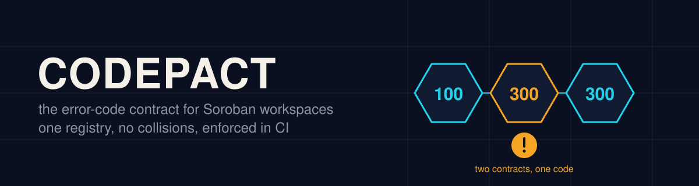

<p align="center">
  
</p>

<p align="center">
  <em>A deployed contract only ever hands a caller a number. Codepact makes sure that number means one thing.</em>
</p>

---

# Codepact Core

**Codepact** is the error-code contract between a Soroban workspace and everyone
who calls it. If two contracts in the same protocol both return `300`, or a
variant quietly shifts because someone inserted a line above it, every
integrator downstream is silently broken and nothing in the build says so.

`codepact-core` is the analyzer and library at the centre of Codepact. It reads
the `#[contracterror]` enums across a workspace, builds one registry of every
numeric code, and fails the build when the workspace breaks its own pact.

## Why this exists

Every rule here comes from a bug that shipped in a real Stellar codebase:

| Rule | Real failure it would have caught |
| --- | --- |
| `duplicate-discriminant` | A contract enum assigning code `54` twice; `rustc` rejects it with E0081, but only after a long build. |
| `code-collision` | A Router and a Factory both defining `300`, so a caller could not tell which contract rejected the call. |
| `range-overlap` | Two enums growing toward each other with no reserved block between them. |
| `implicit-discriminant` | A variant with no explicit code, whose value silently changes when a variant is inserted above it. |
| `range-violation` | A code that escaped the block its contract was allocated. |

## Install

Requires Node.js 20 or newer. There are no runtime dependencies, so it runs in
CI without a Rust toolchain and without a lockfile.

```bash
git clone https://github.com/codepacct/codepact-core.git
cd codepact-core
node bin/codepact.js --help
```

## Usage

```bash
# Check a workspace
node bin/codepact.js contracts/

# Enforce the code blocks each contract is allowed to use
node bin/codepact.js contracts/ --config codepact.config.json

# Generate a committed registry of every error code
node bin/codepact.js contracts/ --markdown --out docs/ERROR_CODES.md

# Fail on warnings too
node bin/codepact.js contracts/ --strict
```

Exit codes: `0` clean, `1` findings failed the run, `2` the tool could not run.

### Configuration

`codepact.config.json` reserves a numeric block per enum and can silence rules:

```json
{
  "ranges": {
    "TokenError": [100, 199],
    "RouterError": [200, 299],
    "FactoryError": [300, 399]
  },
  "ignore": ["implicit-discriminant"]
}
```

## Library API

```js
import { parseContractErrors, analyze, toMarkdown } from "@codepact/core"

const enums = parseContractErrors(source, "contracts/router/src/error.rs")
const findings = analyze(enums, { ranges: { RouterError: [200, 299] } })
console.log(toMarkdown(enums, findings))
```

## What the parser understands

The parser is lexical, not a full Rust front end, so that it can run anywhere.
It recognises `#[contracterror]` enums with explicit decimal or hexadecimal
discriminants, implicit discriminants, per-variant attributes such as `#[cfg]`,
and trailing commas. It correctly ignores anything inside comments, string
literals, raw strings and character literals.

Two known gaps are tracked as issues rather than hidden: fully qualified
`#[soroban_sdk::contracterror]` attributes are skipped, and discriminants given
as a named constant are read as implicit. Both are open for contribution.

## Repository layout

```
bin/codepact.js   CLI entry point
src/comments.js   offset-preserving blanking of comments and literals
src/parse.js      #[contracterror] enum parser
src/analyze.js    rules and findings
src/report.js     text and Markdown reporters
test/             node:test suites, no install required
examples/         a clean workspace and a deliberately broken one
assets/           brand mark and banner
```

## Brand

The mark is two hexagonal contract plates locked together with a seal pressed
into the join: two independent contracts, one agreement about what a code means.

| | |
| --- | --- |
| Navy | `#0B1020` |
| Amber seal | `#F5A524` |
| Cyan link | `#22D3EE` |
| Off-white | `#F5F0E8` |

## Contributing

See [CONTRIBUTING.md](CONTRIBUTING.md). Every change lands through a pull
request, including the maintainer's own.

## License

MIT

## Adopt an existing workspace with a baseline

A baseline records findings you intentionally accept today so later runs can
fail on new findings. Review the file before committing it; it is not a fix and
must not be used to hide new problems. Use the same working directory, scan paths,
and config in both commands so finding file paths remain stable:

```bash
node bin/codepact.js contracts/ --config codepact.config.json --write-baseline codepact.baseline.json
node bin/codepact.js contracts/ --config codepact.config.json --baseline codepact.baseline.json --strict
```

Writing a new baseline exits 0 on success and refuses to overwrite an existing
file. Baseline runs apply `ignore` configuration first, report stale entries,
and fail on new errors (or new warnings with `--strict`). JSON output includes
baseline acceptance and stale details; text and Markdown report them too.
Finding identities exclude line numbers and messages but include affected files,
enums, variants and, where relevant, codes and ranges. Changed identities are
new findings; review and remove stale entries. Malformed or ambiguous duplicate
identities cause an execution error rather than silently hiding findings.
The baseline covers only what this lexical parser can recognize; it is not a
security audit.
